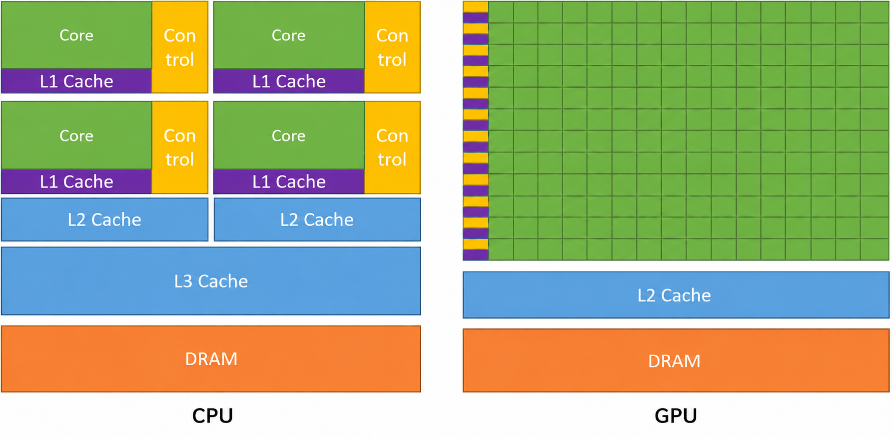

CPU: 中央处理器 
- 通用
- 高时钟频率
- 核心数量少
- 缓存大
- 低延迟
- 低吞吐量

GPU: 图形处理器 
- 专用
- 低时钟频率
- 核心数量多
- 缓存小
- 高延迟
- 高吞吐量

TPU: 张量处理器 
- 用于深度学习算法(矩阵乘法等)的专用 GPU

FPGA: 现场可编程门阵列 
- 可重新配置以执行特定任务的专用硬件
- 极低延迟
- 极高吞吐量
- 极高功耗
- 极高成本

# 是什么让 GPU 在深度学习中如此之快？

CPU(主机)
- 最小化单个任务的耗时
- 指标：延迟，单位为秒

GPU(设备)
- 最大化吞吐量
- 指标：吞吐量，单位为每秒完成的任务数(例如：每毫秒处理的像素数)

# 典型的 CUDA 程序
1. CPU 分配 CPU 内存
2. CPU 将数据复制到 GPU
3. CPU 在 GPU 上启动核函数(处理在这里完成)
4. CPU 将结果从 GPU 复制回 CPU，以便利用结果完成有用的工作

核函数看起来像一个串行程序，其中完全没有提到并行性。想象你正尝试完成一个拼图，而你得到的信息只有每块拼图的位置。高层算法会被设计为接收这些单独的拼图块，并为每一块解决一个问题：“把这块拼图放到正确的位置”。只要所有拼图块最终都组装在正确的位置，这个方法就行得通。你不需要从一个角开始，一路拼到另一边。只要各块拼图之间互不干扰，你就可以同时拼好多个拼图块。

# 一些需要记住的术语
- 核函数
- 线程、线程块和网格
- GEMM = 通用 矩阵 乘法
- SGEMM = 单精度(fp32)通用 矩阵 乘法
- CPU/主机/函数 与 GPU/设备/核函数
- CPU 被称为主机，它执行函数。 
- GPU 被称为设备，它执行称为核函数的 GPU 函数。
