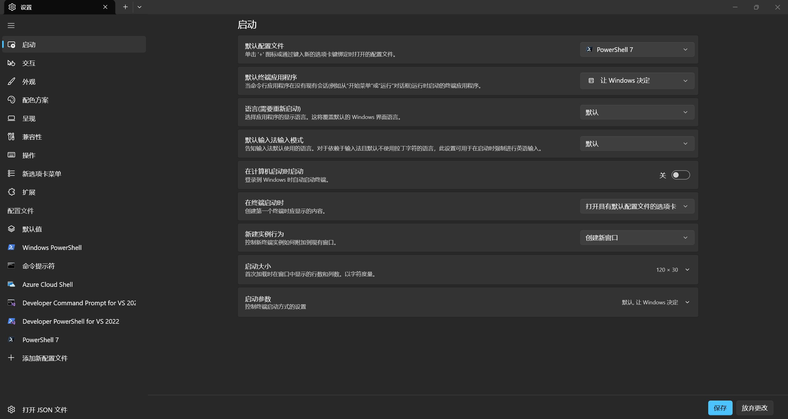

下载 `PowerShell 7` ：https://github.com/PowerShell/PowerShell

选择版本号为 `PowerShell-7.x.x-win-x64.msi` 的安装包

安装完成后查看系统环境变量 `Path` 中是否有 PowerShell 7

# VSCode

打开 VSCode 设置，切换到 `settings.json` 配置，加入以下配置：

```json
"terminal.integrated.profiles.windows": {
    "PowerShell 7": {
        "path": "D:/PowerShell/7/pwsh.exe",//注意切换路径
        "icon": "terminal-powershell"
    }
},
"terminal.integrated.defaultProfile.windows": "PowerShell 7",
```

配置完后打开终端，输入 `$PSVersionTable` 测试，若成功则应显示：

```
PS C:\Users\A> $PSVersionTable

Name                           Value
----                           -----
PSVersion                      7.6.7
PSEdition                      Core
GitCommitId                    7.6.7
OS                             Microsoft Windows 10.0.26300
Platform                       Win32NT
PSCompatibleVersions           {1.0, 2.0, 3.0, 4.0…}
PSRemotingProtocolVersion      2.4
SerializationVersion           1.1.0.1
WSManStackVersion              3.0
```

# 系统

打开 Windows 终端，进入设置，左侧下滑找到添加新配置文件，设置如下：

- 名称：PowerShell 7
- 命令行：`D:\PowerShell\7\pwsh.exe` (注意修改路径)
- 启动目录：`%USERPROFILE%`

保存配置，设置页面左侧找到启动，默认配置文件选择 PowerShell 7

